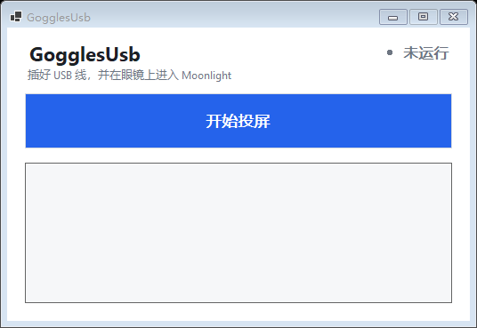

# GogglesUsb

**One-click PC → DJI FPV Goggles V2 casting.** A small launcher that bundles [Sunshine](https://github.com/LizardByte/Sunshine) and [dji-moonlight](https://github.com/fpv-wtf/dji-moonlight-gui) into one portable folder. This program only handles the UI, orchestration and the start/stop switch — replacing the previously complicated manual setup (start Sunshine, pair by PIN, run the relay, tweak parameters).

- **No installation** — no registry, no service, no system changes; copy the folder anywhere and run it
- **Everything in one folder** — Sunshine, the moonlight relay, pairing keys, config and logs all live next to the exe
- **One button** — `Start` / `Stop`; closing the window stops every process
- **Does not touch your own Sunshine install** — it runs its own instance on port `48010`, so an existing service on 47989 keeps working

Fixed stream settings: **1440×810 @ 120 fps, 20 Mbps, H.264** (what the official GUI effectively uses on the goggles).

### Requirements

- Windows 10 / 11 (x64)
- **.NET 10 Desktop Runtime** for the portable package — *or* use the single-file build, which needs no runtime at all
- Goggles with [`dji-moonlight-shim`](https://github.com/fpv-wtf/dji-moonlight-shim) installed, connected over USB

### Usage

1. Plug the goggles in over USB and open **Moonlight** on them (the screen becomes a full-screen image)
2. Double-click `GogglesUsb.exe`, press **开始投屏** (Start)
3. Closing the window stops everything

*Built with AI assistance.* 中文说明见下方 ↓

---
**中文：把电脑画面投到大疆 DJI FPV Goggles V2**（`dji-moonlight-shim` 方案），一个按钮，绿色便携。



---

## 它做什么

官方能跑通的链路是：

```
Sunshine（GPU 硬件编码 H.264）→ moonlight 转发器（-platform dji_net）→ 眼镜 shim → 屏幕
```

这个程序把这条链路封成一个窗口：

- **一个按钮**：开始投屏 / 停止投屏，没有别的开关
- **不安装**：不写注册表、不装服务、不改系统；整个文件夹拷走就能用
- **所有数据都在程序目录**：`sunshine\`（本体+配置+证书）、`relay\`（转发器）、`keys\`（配对密钥）、日志
- **关掉就全停**：Sunshine 和转发器进程树一起结束
- **不碰你系统里的 Sunshine**：程序用独立端口 `48010` 跑自己的实例，系统里那个 47989 的服务不受影响

参数是固定的（和官方 GUI 实际在跑的一致）：**1440×810 / 120fps / 20Mbps / H.264**。

---

## 用法

1. 眼镜用 **USB 线**连电脑，菜单进 **Moonlight**（shim），屏幕变成一张全屏图 = 接管成功（按 **BACK** 退出）
2. 双击 `GogglesUsb.exe`
3. 点 **开始投屏**

关窗口 = 停止并结束所有进程。

> 转发器里眼镜地址写死为 `192.168.42.5`（`dji_net.c` 里 `inet_addr("192.168.42.5")`）。
> USB 连上后眼镜就是这块网卡的 DHCP 服务器，一般就是 `.5`。

---

## 便携包结构

```
GogglesUsb-portable\
├── GogglesUsb.exe / .dll / .json   程序（.NET 10 Desktop Runtime）
├── sunshine\                       Sunshine 本体 + config（含 host 证书、配对状态）
├── relay\moonlight\moonlight.exe   官方 moonlight 转发器
├── keys\                           配对密钥（已配对，免重配）
└── README.md
```

约 **113 MB**（`sunshine.exe` 本身 71 MB）。自己打包：`.\pack-portable.ps1 -SunshinePath "C:\Program Files\Sunshine"`。

> 目录不可写时（比如放在 `C:\Program Files`）才会退回 `%LOCALAPPDATA%\GogglesUsb`。

---

## 单文件版（免装 .NET 运行时）

```powershell
.\make-singlefile.ps1          # 生成 dist-single\GogglesUsb.exe（约 70MB，单文件自包含）
```

- 目标电脑**不需要装 .NET 运行时**，双击就能跑
- 第一次运行会在 exe 旁边自动下载 `sunshine\` 和 `relay\`（约 70MB），之后离线可用
- 推 tag（`git push origin v2.0.0`）时 GitHub Actions 会自动构建并挂到 Release 上

---

## 排错

| 现象 | 处理 |
|---|---|
| 日志刷 `connect failed: ... Connection timed out` | 眼镜的 USB 网络没起来：换数据线/换 USB 口、眼镜开机并进入 Moonlight；「网络连接」里要能看到 `Remote NDIS` 设备且拿到 192.168.42.x 地址 |
| 一直“准备中” | 看日志框；端口 48010 被占用时程序会先清掉上次残留的 sunshine.exe |
| 转发器秒退 | 常见：眼镜没连、IP 不是 192.168.42.5、shim 没开 |
| 串流中途断开（动一下设备管理器/UAC 就断） | Windows 把 USB 端口挂起了：设备管理器里对 `USB Root Hub` 和 `Remote NDIS` 设备取消「允许计算机关闭此设备以节约电源」；电源选项 → USB 选择性暂停 → 禁用。程序会自动重连（最多 60 秒） |
| 有画面但卡 | 这台机器不适合再调参数（已固定）；检查 USB 直插主板、别过 Hub |
| 需要重新配对 | 删掉 `keys\` 和 `sunshine\config\sunshine_state.json` 再启动，会重新自动配对 |

日志：`sunshine\config\sunshine.log`（Sunshine 的完整记录）。

---

## 从源码构建

```powershell
dotnet build .\src\GogglesUsb\GogglesUsb.csproj -c Release
# 自检（不需要眼镜）：.\src\GogglesUsb\bin\Release\net10.0-windows\GogglesUsb.exe --selftest
```

---

## 为什么不用自己写编码器

最初试过「自己抓屏 + Media Foundation 编码 + 自己发帧」，DJI 的解码器不接受（黑屏）。
排查过：AU 帧边界、B 帧（shim 给每帧 pts 恒为 0，有 B 帧永远排不出序）、AUD/SEI（对齐 Moonlight 解包器）、
16 对齐分辨率（避免 SPS cropping）、Main/Baseline profile —— 都不行。
换成 Sunshine 的 NVENC 码流 + 官方转发器后一次通过。所以最终版只做调度。

---

## 致谢与许可

本仓库代码：**MIT**。

运行时组件（本仓库不包含，便携包内自带）：

- [Sunshine](https://github.com/LizardByte/Sunshine) —— GPL-3.0
- [dji-moonlight-gui](https://github.com/fpv-wtf/dji-moonlight-gui) / [dji-moonlight-embedded](https://github.com/fpv-wtf/dji-moonlight-embedded) —— GPL-3.0
- [dji-moonlight-shim](https://github.com/fpv-wtf/dji-moonlight-shim) —— 眼镜端，需自行安装

如果重新分发带这些二进制的便携包，请遵守对应 GPL 许可。